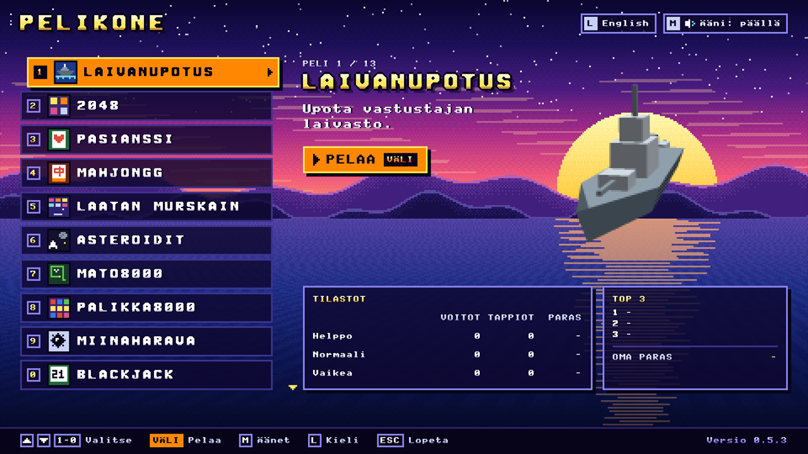
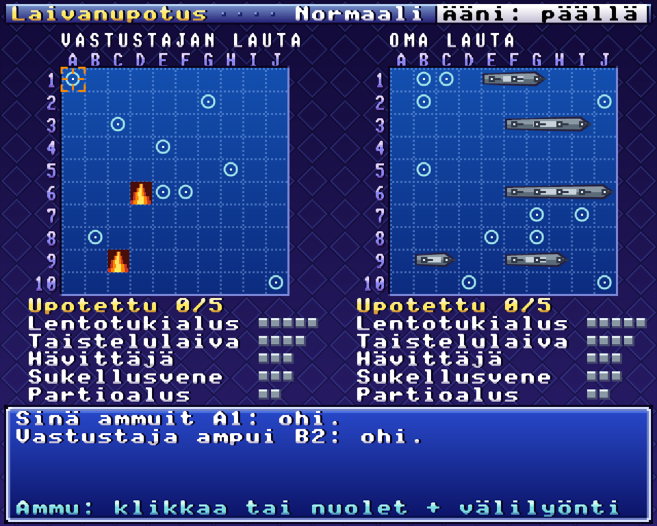
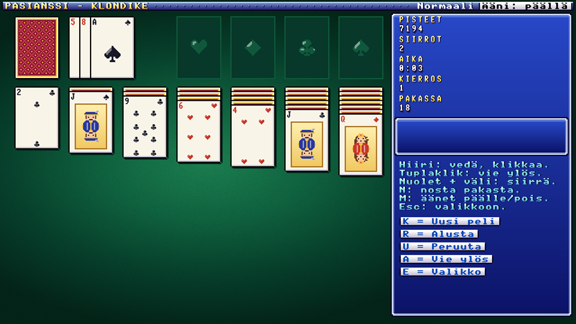
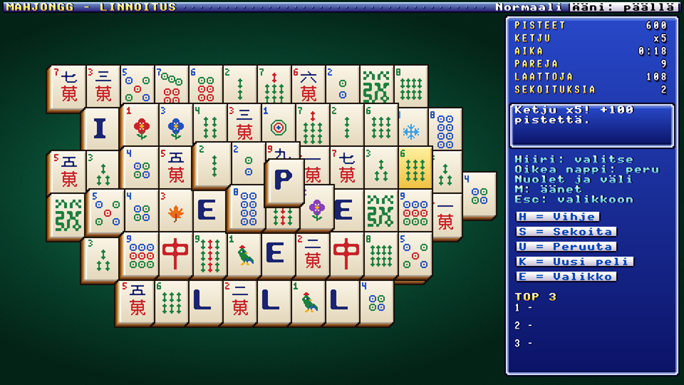
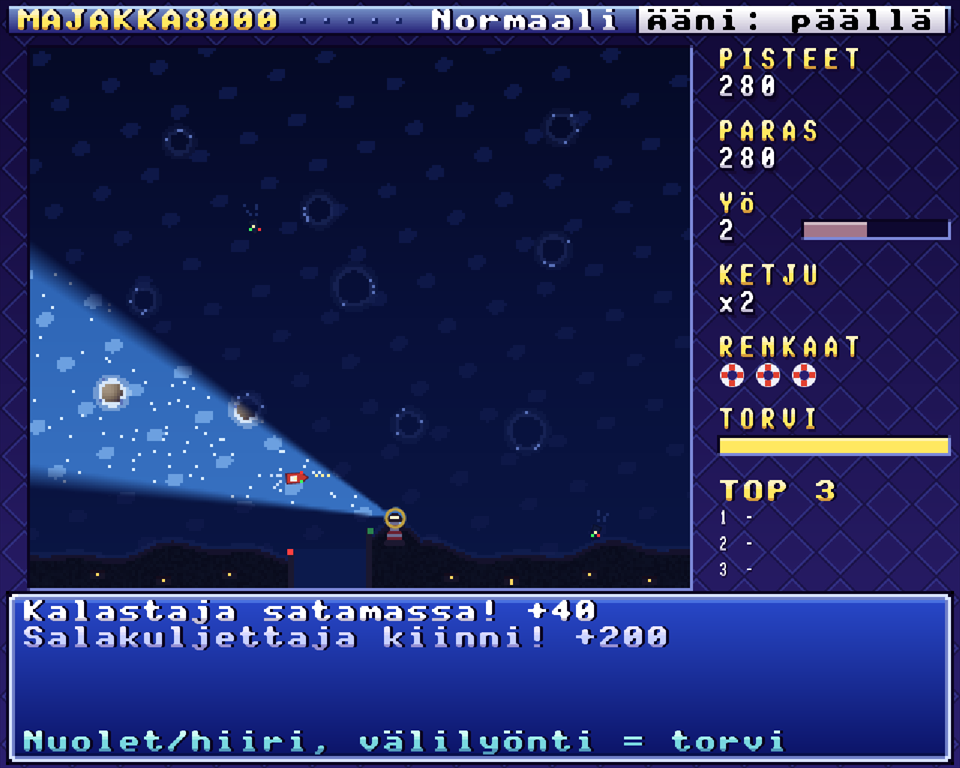

# Klassikot8000

**Suomeksi** | [English](README.md)

Tylsää? Viisitoista vanhan liiton peliä yhdessä pienessä ikkunassa, SNES- ja Mega Drive -henkisessä 16-bittisessä asussa. Ei tiliä, ei mainoksia, ei opeteltavaa. Avaa, valitse peli ja anna ajan kulua.

Pyörii vaikka perunalla. AB:n OG ideasta.

| | |
| --- | --- |
|  |  |
| Laivanupotus | Pasianssi: Klondike |
|  |  |
| Mahjongg | Majakka8000 |

## Pelit

### Laivanupotus

Sinä vastaan tietokone. Kummallakin on viisi laivaa, ja ammutte vuorotellen, kunnes toisen laivasto makaa pohjassa. Laivat eivät kosketa toisiaan edes kulmittain, joten uponneen laivan ympärys merkitään laudalle. Ennen taistelua voit siirtää ja kääntää omia laivojasi tai arpoa ne uudelleen. Peli pitää kirjaa voitoista, tappioista ja vähimmistä laukauksista tasoittain. Voitto antaa top-listalle pisteitä: jokainen säästetty laukaus tuo pisteen, ja vaikeampi taso kertoo ne (normaali kahdella, vaikea kolmella). Kumpi purjehtii kotiin perheensä luo?

*Hiiri tai nuolet ja välilyönti. Sijoittaessa 1–5 nostaa laivan, R tai hiiren oikea kääntää ja A arpoo.*

### 2048

Työnnä lukuja laudalla, yhdistä samat ja tavoittele 2048:aa. Vielä yksi siirto, ja sitten lopetat. Ehkä. Kesken jäänyt peli odottaa seuraavaa kertaa.

*Nuolet tai hiiri.*

### Pasianssi

Kolme peliä saman kortin alla, ja jokaisella on oma top-listansa. Pisteet tulevat ajasta: mitä nopeammin voitat, sitä enemmän saat, ja vaikeampi taso kertoo ne (normaali kahdella, vaikea kolmella).

**Klondike** on se tuttu, jonka kanssa on kulutettu tuhansia työpäiviä. Helpolla nostat kortin kerrallaan ja saat perua, vaikealla nostat kolme, pakan saa käydä läpi kolmesti eikä mitään voi perua.

**Spider** jaetaan kahdesta pakasta kymmeneen sarakkeeseen. Kokoa saman maan sarjat kuninkaasta ässään, niin ne poistuvat pöydältä. Helpolla kortteja on yhtä maata, normaalilla kahta ja vaikealla neljää. Perua saa aina, koska neljää maata ei muuten juuri voita.

**Haasteet** avautuvat alkuruudulta H-näppäimellä: pelaaja liittyy kesken olevaan peliin ja koettaa voittaa sen. Jokaisessa kolmessa pelissä on 20 haastetta, jotka vaikeutuvat järjestyksessä. Jokainen haaste on varmasti voitettavissa, koska testit pelaavat tallennetun ratkaisun läpi, ja perua saa aina alkutilanteeseen asti. Haasteilla on oma top-listansa, jonka tulos on kaikkien haasteiden parhaiden pisteiden summa.

**Pyramidi** puretaan pareittain: kahden vapaan kortin summan on oltava 13, ja kuningas lähtee yksin. Jätepinon kaksi päällimmäistä korttia ovat pelattavissa. Helpolla pakkaa saa kierrättää vapaasti, normaalilla käydä läpi kolmesti, ja vaikealla kahdesti ilman peruutusta.

*Hiiri tai nuolet ja välilyönti.*

### Mahjongg

Laattapasianssi, se yksinpelattava. Laatat ovat pöydällä kerroksittain, ja pois saa ottaa kaksi samaa vapaata laattaa. Vapaan laatan päällä ei ole mitään, ja ainakin toinen sivu on auki. Kukat ja vuodenajat käyvät pariksi kenen tahansa oman sarjansa laatan kanssa. Jokainen jako on ratkaistavissa, mutta väärä järjestys vie silti umpikujaan. Silloin auttaa sekoitus, joka jakaa jäljellä olevat laatat uudelleen ratkeavaan järjestykseen. Peli päättyy, kun lauta on tyhjä tai pareja ei enää ole eikä sekoituksia ole jäljellä.

Helpolla puretaan 72 laatan pyramidi, vapaat laatat erottuvat muista ja sekoituksia on kolme. Normaalilla puretaan 124 laatan linnoitus kahdella sekoituksella. Vaikealla vastassa on kaikkien 144 laatan vuori, sekoituksia on yksi eikä mitään voi perua.

Pari antaa 10 pistettä ja kukka- tai vuodenaikapari 20. Kun seuraava pari löytyy neljän sekunnin sisällä, ketju kasvaa ja kertoo pisteet viiteen asti. Vihje maksaa 20 pistettä ja sekoitus 50, ja kumpikin katkaisee ketjun. Tyhjä lauta tuo 500 pisteen bonuksen ja lisäksi pisteen jokaisesta sekunnista, joka aikarajasta jäi (helpolla 5, normaalilla 10 ja vaikealla 15 minuuttia). Vaikeampi taso kertoo kaikki pisteet (normaali kahdella, vaikea kolmella).

*Hiiri tai nuolet ja välilyönti. Hiiren oikea peruu valinnan, H näyttää vihjeen, S sekoittaa, U palauttaa edellisen parin ja K aloittaa uuden pelin.*

### Laatan murskain

Pidä pallo kentällä ja riko tiilet. 50 kenttää, kolme palloa, ja nopeasta läpäisystä saa lisäpisteitä. Valkoinen tiili tuo toisen pallon ja kasvattaa mailaa, ja niin kauan kuin molemmat pallot ovat kentällä, tiilistä saa tuplapisteet. Musta tiili tekee pallosta 30 % nopeamman superpallon, joka menee kaikkien tiilien läpi ja antaa nelinkertaiset pisteet. Valkoinen tiili tuplaa myös superpallon. Kahden pallon vahtiminen on juuri niin vaikeaa kuin miltä se kuulostaa.

*Hiiri, nuolet tai A/D, laukaisu välilyönnillä tai klikkauksella.*

### Asteroidit

Yksinäinen alus, loputtomasti kiviä. Iso kivi hajoaa pienemmiksi, lentävät lautaset ampuvat takaisin, ja kun tilanne käy mahdottomaksi, voit aina hypätä sokkona jonnekin muualle. Aluksia on kolme. 10 000 pistettä tuo uuden, ja jokainen seuraava maksaa edellistä enemmän.

*Nuolet, WASD tai hiiri, hiiren oikea kiihdyttää, välilyönti ampuu, H hyppää.*

### Mato8000

Matopeli, jossa itseensä törmääminen on koko idea. Osuma sulkee silmukan, ja kaikki sen sisään jäänyt on saalista. Silmukka kuluttaa kuitenkin madon pituutta, joten omenoita kannattaa syödä välillä. Mitä enemmän saat kerralla, sitä moninkertaisemmat pisteet. Varo seiniä ja itikoita.

*Nuolet, WASD tai hiiri.*

### Palikka8000

Vaihda kahta vierekkäistä palikkaa, ja kolme samaa suorassa katoaa. Yläpuolelta putoavat uudet saattavat jatkaa ketjua, ja jokainen ketjun lenkki kertoo pisteet. Neljästä syntyy pommi ja viiden suorasta kaikkipalikka, joka vie mukanaan kaikki naapurinsa väriset. Tasojen myötä värejä tulee lisää, ja peli päättyy, kun yhtään siirtoa ei enää ole.

*Hiiri tai nuolet ja välilyönti.*

### Miinaharava

Se toinen tuttu toimistoklassikko. Numero kertoo, montako miinaa ruudun ympärillä on, ja loput pitää päätellä. Ensimmäinen avaus on aina turvallinen, joten ensimmäistä räjähdystä ei voi laittaa huonon tuurin piikkiin. Kolme tasoa, ja jokaisella oma ennätysaikansa. Voitto antaa top-listalle pisteitä: mitä nopeammin voitat, sitä enemmän saat, ja vaikeampi taso kertoo ne (normaali kahdella, vaikea kolmella).

*Hiiren vasen avaa ja oikea liputtaa, tai nuolet, välilyönti ja F.*

### Blackjack

Sinä vastaan tietokonejakaja, ja pelivälineenä leikkiraha. Alussa on 300 rahaa ja pienin panos on 1. Pääse lähemmäs 21:tä kuin jakaja, mutta älä yli. Voit ottaa kortin, jäädä, tuplata tai halkaista parin, ja kun jakajalla on ässä esillä, voit ottaa vakuutuksen. Blackjack maksaa 3:2 ja vakuutus 2:1, ja jakaja jää aina 17:ään. Kengässä on kuusi pakkaa. Kun rahat loppuvat, peli alkaa alusta. Rahat eivät säily, kun poistut valikkoon, mutta voitto, jonka viet pöydästä, on tuloksesi.

*Hiiri tai näppäimet: nuolet ja 1–4 panokselle, välilyönti jakaa, O ottaa, J jää, T tuplaa, H halkaisee, V vakuuttaa, N ei vakuuta.*

### Texas Hold'em

No limit -pokeria neljää tietokonetta vastaan. Kaikilla on alussa 1000 rahaa, ja viimeinen rahoissa voittaa. Kaksi omaa korttia ja viisi yhteistä: paras viiden kortin käsi vie potin. Blindit alkavat 10/20 ja tuplaantuvat kymmenen jaon välein, joten peli päättyy aina. Säännöt ovat turnauksista tutut sivupotteineen, pienimpine korotuksineen ja kuolleine nappeineen. Koneet eivät kurki: ne näkevät vain omat ja yhteiset kortit. Rahat eivät säily, kun poistut valikkoon, mutta voitto, jonka viet pöydästä, on tuloksesi.

*Hiiri tai näppäimet: V tarkistaa tai maksaa, K skippaa, R korottaa, nuolet ja 1–4 muuttavat korotusta, välilyönti hoputtaa koneita ja jakaa seuraavan käden.*

### Majakka8000

Olet majakanvartija myrskyisenä yönä. Laivat tulevat pimeästä kohti satamaa eivätkä näe karikoita. Pimeässä laiva pitää suuntansa, ja virta vie sitä sivuun. Kun käännät keilan laivan päälle, kapteeni näkee karikot, kiertää ne ja kääntyy satamaan, ja muistaa reitin vielä hetken. Lamppu on raskas ja kääntyy hitaasti, joten koko yö on sitä, kenet valaiset seuraavaksi. Pimeällä merellä karikon paljastaa vain vaahto, ja laivasta näkyvät kulkuvalot. Sumutorvi hidastaa hetkeksi kaikkia laivoja ja latautuu hitaasti. Toisesta yöstä alkaen merellä liikkuu myös valottomia salakuljettajia: pidä keila niiden päällä, niin ne jäävät kiinni. Yö kestää puolitoista minuuttia, ja aamu tuo merellä olevat laivat kotiin. Uusi yö tuo uudet karikot, enemmän laivoja ja kovemman virran. Kolme haaksirikkoa päättää pelin.

Satamaan päässyt vene antaa 10 pistettä, kalastaja 20 ja rahtilaiva 50, ja salakuljettaja 100. Peräkkäin perille päässeet laivat kasvattavat kerrointa viiteen asti, ja haaksirikko tai merelle eksynyt laiva nollaa sen. Yö ilman haaksirikkoja tuo bonuksen. Tasot eroavat keilan leveydessä ja nopeudessa: helpolla karikot näkyvät pimeässäkin himmeästi, vaikealla sumu lyhentää keilaa ja tuulenpuuskat kääntävät laivoja. Vaikeampi taso kertoo pisteet (normaali kahdella, vaikea kolmella).

*Hiiri, nuolet tai A/D kääntävät keilaa, välilyönti tai klikkaus soittaa sumutorvea.*

### Kaivos8000

Olet ahne kullankaivaja. Kaivat maan alle hissin vierestä, ja pimeässä näet vain sen, minkä lamppusi valaisee; kulta ja timantit välähtelevät kauempaa. Maa kantaa itsensä vain lyhyen matkan: liian leveä tunneli alkaa ritistä, varisee pölyä ja sortuu, savi kestää vähän leveämmän katon, hiekka valuu heti alta kaivettuna ja irtokivi putoaa, kun sen alta kaivetaan. Ritisevän katon voi vielä pelastaa pystyttämällä sen alle tuen. Ylös kiivetään tikkailla, joita on kaksi kertaa tukien verran: ylös-nuoli pystyttää tikkaat omaan ruutuun ja kiipeää. Tikkaat eivät kanna kattoa, ja putoava maa murskaa ne. Myös tukea pitkin voi kiivetä. Löydöt kulkevat säkissä, ja ne kirjautuvat pisteiksi vasta hissillä: sortuma tai liian korkea pudotus vie kypärän ja koko säkin. Kun hissiin on viety tason kiintiön verran kultaa, hissi vie syvemmälle uuteen kaivokseen, jossa on enemmän hiekkaa, kiviä ja luolia. Lampun öljy palaa maan alla ja täyttyy pinnalla tai löydetystä kannusta, ja valo kutistuu öljyn mukana. Haudatuista puunipuista saa lisää tukia. Kolme kypärää menetettynä peli päättyy.

Kulta on syvemmällä arvokkaampaa (10–35 pistettä) ja timantti 100 pistettä tai enemmän. Täysi kiintiö antaa tasobonuksen, ja jokainen käyttämättä jäänyt tuki kasvattaa sitä. Tasot eroavat tukien, öljyn ja valon määrässä, katon kestossa ja vaarojen määrässä. Vaikeampi taso kertoo pisteet (normaali kahdella, vaikea kolmella).

*Nuolet, WASD tai klikkaus kaivavat ja kävelevät ruudun kerrallaan (pohjassa pidetty nuoli jatkaa liikettä hetken kuluttua), ylös-nuoli tyhjässä ruudussa pystyttää tikkaat, välilyönti, oikea nappi tai klikkaus omaan ruutuun pystyttää tai purkaa tuen (tikkaissa vaihtaa ne tueksi), ja R heittää hätäköyden, joka nostaa pinnalle kypärän ja säkin hinnalla.*

### Jatsi

Viisi noppaa, kolme heittoa vuorossa ja 15 riviä täytettävänä pohjoismaisin säännöin: ylhäällä ykkösistä kuutosiin, ja 63 pistettä niistä tuo 50 pisteen bonuksen. Alla ovat pari, kaksi paria, kolme ja neljä samaa, pieni (1–5) ja suuri (2–6) suora, täyskäsi, sattuma ja jatsi. Lukitse noppia heittojen välissä ja kirjaa joka vuorolla yksi rivi; rivi, johon nopat eivät käy, jää nollaksi, joten viivaa viisaasti. Pöytä katetaan alkuruudulla: enintään neljä pelaajaa, kukin ihminen tai kone, joten voit pelata konetta vastaan, kavereiden kanssa samalla koneella tai yksin. Taso on koneiden taito: helppo on ahne, normaali pelaa järkevästi ja vaikea punnitsee jokaisen lukituksen todennäköisyyksillä. Jokaisen ihmisen summa menee top-listalle hänen omalla nimellään, ja voitto koneista kertoo sen tasolla (normaali kahdella, vaikea kolmella). Kesken jäänyt peli odottaa seuraavaa kertaa.

*Välilyönti tai Heitä-nappi heittää, 1–5 tai klikkaus lukitsee nopan, nuolet valitsevat rivin ja K tai klikkaus kirjaa sen. Viivaus vaatii toisen painalluksen. Alkuruudulla nuolet valitsevat paikan ja pelaajan, ja N nimeää ihmisen. Kun kone pelaa, välilyönti pelaa sen vuoron heti loppuun.*
### 5 suora

Ruutupaperin klassikko 15x15-laudalla konetta tai kaveria vastaan. Ensimmäinen viiden suora vaakaan, pystyyn tai vinoon voittaa (pidempikin suora käy). Täyteen laudattu peli päättyy tasan. Konetta vastaan olet risti ja aloitat. Helppo kone tekee välillä virheitä, normaali torjuu uhat ja hyökkää, ja vaikea etsii pakottavia nelos- ja kolmossarjoja ja varoo jättämästä sinulle sellaista. Voitto tuo pisteitä sitä enemmän, mitä vähemmillä omilla siirroilla se syntyy, ja taso kertoo ne (normaali kahdella, vaikea kolmella). Kaksinpelissä kaksi ihmistä pelaa vuorotellen samalla koneella, aloittaja vaihtuu joka pelissä, eikä tulos mene listalle. Sivuikkunat laskevat istunnon voitot.

*Klikkaus merkitsee ruudun, tai nuolet siirtävät kursoria ja välilyönti merkitsee. Alkuruudulla ylös- ja alas-nuoli vaihtavat konepelin ja kaksinpelin, ja 1–3 valitsevat koneen tason.*

## Hyvä tietää

- Valikossa peli valitaan nuolilla, numeroilla 1–0, hiiren rullalla tai osoittamalla, ja välilyönti tai klikkaus aloittaa sen.
- `Esc` palaa pelistä valikkoon. Toimintapeleissä ja Palikka8000:ssa se pysäyttää ensin pelin, jottei vahinkopainallus vie peliä, ja toinen painallus palaa valikkoon. Valikossa Esc sulkee ohjelman vasta toisella painalluksella. Kesken jäänyt hyvä tulos pääsee silti listalle. `P` pysäyttää toimintapelit, `M` vaimentaa äänet ja `L` vaihtaa valikossa kielen suomen ja englannin välillä.
- Valittu taso, pasianssin laji ja viimeksi valittu peli säilyvät seuraavaan kertaan.
- Jokaisella pelillä on Top 3 -lista myös netissä, ja valikko näyttää sen valitun pelin kohdalla yhdessä oman ennätyksesi kanssa. Laivanupotuksen kohdalla valikko näyttää myös voitot ja tappiot tasoittain. Ilman nettiä pelaat ihan yhtä hyvin.
- Valikko näyttää pelin version ja kertoo, jos GitHubissa on uudempi julkaisu. Peli katsoo asian käynnistyessään, ja ilmoitusta klikkaamalla julkaisusivu aukeaa selaimeen.

## Pelaamaan

Hae Windows-paketti (`windows-x64`) [julkaisuista](https://github.com/VilhoValittu/Klassikot8000/releases/latest), pura se ja käynnistä `klassikot8000-<versio>.exe`.

Lähdekoodista käännetty peli toimii samoin, mutta ei lähetä tuloksia nettilistalle: lista hyväksyy vain julkaisupakettien tulokset.

## Lisenssi

Klassikot8000 on julkaistu [MIT-lisenssillä](LICENSE). Julkaisupaketeissa on sen lisäksi käytettyjen kirjastojen lisenssit tiedostossa `THIRD-PARTY-LICENSES.txt`.
